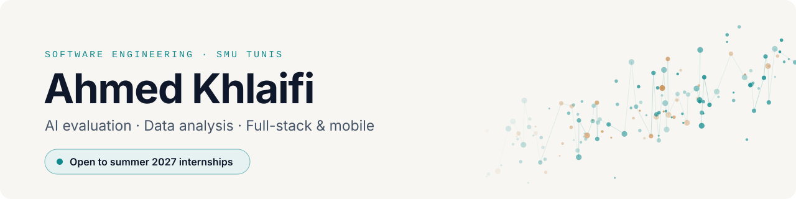

<picture>
  <source media="(prefers-color-scheme: dark)" srcset="assets/banner-dark.svg">
  
</picture>

  
  
  

I'm a software engineering student at South Mediterranean University in Tunis. I like projects with real data and real users: testing how language models handle uncertainty, finding out why Tunisair flights run late, and building sensors that warn phosphate workers in my hometown about dangerous dust.

<table>
  <tr>
    <td align="center" width="33%"><h2>94,061</h2>flights cleaned and analysed</td>
    <td align="center" width="33%"><h2>8 × 3</h2>prompt designs × LLMs evaluated</td>
    <td align="center" width="33%"><h2>18</h2>workers covered by LastDust sensors</td>
  </tr>
</table>

## Featured projects

<table>
  <tr>
    <td width="50%" valign="top">
      LLM RESEARCH
      <h3><a href="https://github.com/Ahmedkhkh/uncertainty-prompting-mmlu">Uncertainty prompting in LLMs</a></h3>
      
Can a prompt make a language model say "I don't know" instead of guessing? I tested 8 prompt designs on Qwen2.5, TinyLlama and Mistral Small with a 500-question MMLU sample, measuring accuracy, abstention, calibration and JSON compliance, and wrote it up as a LaTeX paper.

      
<b>Finding:</b> on small models, prompts that seemed to cut wrong answers mostly broke the output format.

      
<code>Python</code> <code>Transformers</code> <code>PyTorch</code> <code>SciPy</code> <code>LaTeX</code>

    </td>
    <td width="50%" valign="top">
      DATA SCIENCE
      <h3><a href="https://github.com/Ahmedkhkh/tunisair-delay-analysis">The Domino Effect: why Tunisair runs late</a></h3>
      
A CRISP-DM study of Tunisair flights from 2016 to 2018, covering cleaning, hypothesis tests, a what-if on turnaround buffers and 33 engineered features.

      
<b>Finding:</b> a flight is delayed 79% of the time when its previous leg was late, against 33% otherwise, and 42% of all delay minutes are inherited.

      
<code>Python</code> <code>pandas</code> <code>SciPy</code> <code>scikit-learn</code> <code>seaborn</code>

    </td>
  </tr>
  <tr>
    <td width="50%" valign="top">
      AI · RAG · TEAM PROJECT
      <h3><a href="https://github.com/MarwenWali/LawyerUp">LawyerUp</a></h3>
      
A platform connecting people with lawyers in Tunisia, with an AI legal assistant. I built the pipeline that parses the Tunisian Constitution article by article and loads it into the assistant's RAG corpus.

      
<code>Python</code> <code>RAG</code> <code>Node.js</code> <code>React Native</code> <code>Supabase</code>

    </td>
    <td width="50%" valign="top">
      IoT · SINCE 2022
      <h3>LastDust</h3>
      
A smart sensor system that alerts phosphate workers in Redeyef, Tunisia, when dust levels become dangerous. I started it with friends and professors. 3 sensors now cover 18 workers, with more planned and a health smartwatch next.

      
<code>Sensors</code> <code>IoT</code> <code>Hardware</code>

    </td>
  </tr>
  <tr>
    <td width="50%" valign="top">
      MOBILE · INTERNSHIP
      <h3>Student journey app</h3>
      
A Flutter app for a language centre that lets students follow their whole journey, from arrival to departure. I built it as a prototype during my internship, and it was tested with students for 2–3 weeks.

      
<code>Flutter</code> <code>Dart</code> <code>Supabase</code>

    </td>
    <td width="50%" valign="top">
      NETWORKING · COURSE PROJECT
      <h3>HTTP client-server system</h3>
      
A Flask server with three client roles running across real laptops. We added the HTTP QUERY method and a man-in-the-middle attack demo with mitmproxy, compared against normal traffic in Wireshark.

      
<code>Python</code> <code>Flask</code> <code>SQLite</code> <code>Wireshark</code> <code>mitmproxy</code>

    </td>
  </tr>
</table>

**Also built:** [GoldenTouch](https://github.com/mariembahri45/GoldenTouch), a team e-commerce app where I built sign-in, sign-up and role-based auth (React, Node.js, MongoDB) · [todolist](https://github.com/Ahmedkhkh/todolist), a React + Vite to-do app

## Experience

**Mobile App Developer Intern** · Taa Marbouta language centre, La Marsa · *Jul – Aug 2026* 
Built the student journey app above with Flutter and Supabase, from requirements to a prototype tested with real students.

## Education

**South Mediterranean University (SMU)**, Tunis · Software Engineering 
Exchange at **Florida State University**, USA · Previously at Dauphine Tunis

## Tech stack

  
  
  
  

  
  
  
  
  
  
  

  
  
  
  
  
  

  
  
  
  
  
  

